# JEMI DevOps Control Center

> **ISE–2 DevOps Project**  
> *Real-time System Observability, Rule-Based Incident Detection, and Automated CI/CD Pipeline*

---

## 1. Project Title & Overview

The **JEMI DevOps Control Center** is a high-performance, single-node DevOps monitoring and operations dashboard built with **Python 3.10**, **Flask**, and **psutil**, backed by a dependency-free vanilla HTML5, CSS3, and JavaScript frontend.

Featuring an ultra-modern, futuristic Heads-Up Display (HUD) theme in violet and electric cyan, JEMI provides system administrators and DevOps engineers with real-time hardware telemetry, automated health probes, threshold-based incident alerting, and containerized deployment readiness.

---

## 2. Problem Statement & Objectives

### Problem Statement
Modern microservice and cloud deployments require real-time visibility into host resource constraints, application health status, and continuous integration pipeline results. Traditional monitoring stacks (e.g., Prometheus + Grafana + Alertmanager) can be overly complex and heavyweight for edge nodes, development clusters, or compact laboratory assignments. 

### Objectives
1. **Lightweight Observability**: Deliver sub-second system telemetry (CPU cores, memory consumption, disk usage, and network I/O) without heavyweight third-party runtime dependencies.
2. **Platform Independence**: Ensure seamless execution across diverse operating systems (Windows development workstations and Ubuntu Linux production/CI runners).
3. **Automated Continuous Integration**: Implement automated test discovery and execution on GitHub Actions triggered by commits and pull requests.
4. **Rule-Based Incident Monitoring**: Provide genuine, rule-evaluated alerts driven by live system metrics rather than mocked or fabricated data.
5. **Containerization Readiness**: Ship production-grade Docker and Docker Compose definitions adhering to least-privilege security principles.

---

## 3. Features Implemented

- **Real-Time Host Telemetry**:
  - CPU utilization with non-blocking polling and logical core reporting.
  - Virtual memory usage (total bytes, used bytes, percentage).
  - Cross-platform filesystem usage with automatic root fallback (`C:\` on Windows, `/` on Linux/POSIX).
  - Network throughput counters with real-time upload/download delta rates.
- **Rule-Based Incident Monitoring (`/api/incidents`)**:
  - Live rule evaluation against DevOps SLA thresholds:
    - **CPU Saturation**: Warning at $\ge 75\%$, Critical at $\ge 90\%$.
    - **Memory Pressure**: Warning at $\ge 80\%$, Critical at $\ge 90\%$.
    - **Storage Capacity**: Warning at $\ge 85\%$, Critical at $\ge 90\%$.
    - **Application Health**: Probe failure triggers critical alerts.
  - Transparent demonstration simulation mode via query parameter (`?simulate=<type>`) clearly distinguishing real system telemetry from simulated test cases.
- **Micro-Frontend HUD**:
  - Native HTML5 Canvas sparklines and historical trend charts (zero client-side npm dependencies).
  - SVG percentage gauge rings with dynamic warn/critical color levels.
  - Filterable, searchable incident table with clickable drawer inspection.
  - LocalStorage preferences (accent theme, compact density, reduced motion, polling intervals).
- **Automated Health Prober (`health_service.py`)**:
  - HTTP endpoint probe measuring status code, response time in milliseconds, and error classification.
- **Continuous Integration (GitHub Actions)**:
  - Automated testing on Ubuntu runners with Python 3.10 and `pytest`.
- **Containerization**:
  - Production `Dockerfile` with unprivileged user (`jemiuser:10001`) and container healthcheck.
  - `docker-compose.yml` for unified one-command local orchestration.

---

## 4. Architecture & Request/Data Flow

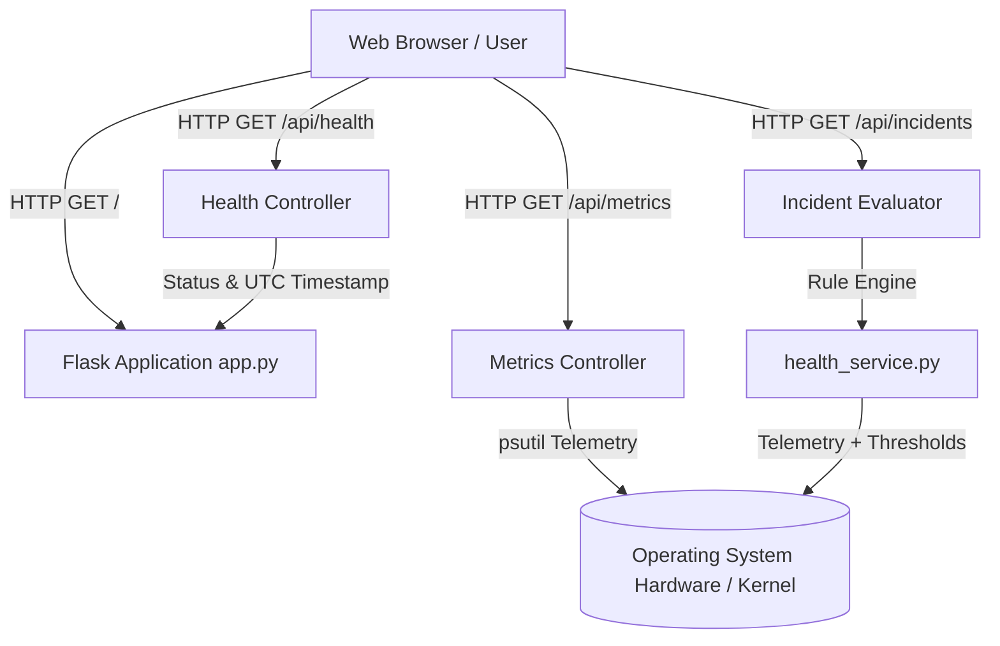

### Data Flow Breakdown
1. **Frontend Request**: The browser client polls `/api/metrics`, `/api/health`, and `/api/incidents` at configurable intervals (default: 5 seconds).
2. **Backend Telemetry Harvesting**:
   - `psutil` collects memory, CPU, disk, and network stats with non-blocking execution.
   - Platform-independent logic (`os.name == "nt" ? "C:\\" : "/"`) resolves the root storage device.
3. **Rule Evaluation**:
   - `evaluate_metrics_rules()` analyzes current telemetry values against SLA thresholds.
   - If limits are exceeded, active incidents are generated; if within limits, baseline operational records are returned.
4. **Client Render**:
   - `jemi.js` receives JSON arrays, updates the HUD rings, streams data points to HTML5 canvas graphs, and updates incident badges and tables.

---

## 5. Technology Stack

| Layer | Technologies |
| :--- | :--- |
| **Backend Language & Framework** | Python 3.10+, Flask 3.1+ |
| **System Telemetry** | `psutil` 7.2+ |
| **Frontend UI & Styling** | Vanilla HTML5, Vanilla CSS3 (Custom HUD Cyberpunk Design), Vanilla JavaScript (ES6+) |
| **Automated Testing** | `pytest` 9.1+, `unittest` |
| **CI/CD Automation** | GitHub Actions (`ubuntu-latest`, Python 3.10) |
| **Containerization** | Docker (multi-stage minimal base `python:3.10-slim`), Docker Compose |

---

## 6. Repository Structure

```
jemi-devops-control-center/
├── .github/
│   └── workflows/
│       └── tests.yml            # GitHub Actions CI workflow (pytest on Ubuntu)
├── screenshots/                 # Submission evidence and screenshots directory
├── static/
│   ├── css/
│   │   └── jemi.css             # Responsive HUD design system and visual theme
│   └── js/
│       └── jemi.js              # Polling controller, Canvas charts, and table logic
├── templates/
│   └── index.html               # Main JEMI DevOps Control Center dashboard
├── tests/
│   └── test_app.py              # Automated test suite (10 unit/integration tests)
├── .dockerignore                 # Exclusions for clean container build context
├── .gitignore                   # Git ignore patterns for venv, cache, and secrets
├── app.py                       # Main Flask web application and API controller
├── docker-compose.yml           # Docker Compose orchestration configuration
├── Dockerfile                   # Hardened production Dockerfile (non-root user)
├── health_service.py            # Endpoint probing and rule-based incident evaluator
├── Jenkinsfile                  # Declarative multi-stage Jenkins CI/CD pipeline definition
├── README.md                    # Project documentation and submission guide
└── requirements.txt             # Python project dependencies with version bounds
```

---

## 7. Prerequisites

- **Operating System**: Windows 10/11, macOS, or Linux (Ubuntu 20.04/22.04+).
- **Python**: Version 3.10 or higher.
- **Git**: Version 2.30 or higher.
- **Docker & Docker Compose** *(Optional for local container verification)*: Docker Desktop on Windows or Docker Engine on Linux.

---

## 8. Installation & Virtual Environment Setup (Windows)

Open **PowerShell** or **Command Prompt** in the project directory:

```powershell
# 1. Clone repository (if not already local)
git clone https://github.com/IronTechVision/jemi-devops-control-center.git
cd jemi-devops-control-center

# 2. Create virtual environment
python -m venv .venv

# 3. Activate virtual environment
# On Windows PowerShell:
.venv\Scripts\Activate.ps1
# (Or on Windows Command Prompt:)
# .venv\Scripts\activate.bat

# 4. Upgrade pip and install dependencies
python -m pip install --upgrade pip
pip install -r requirements.txt
```

---

## 9. Running the Application Locally

Start the Flask application using your virtual environment:

```powershell
# Default startup (http://127.0.0.1:5000)
python app.py
```

### Environment Variable Overrides
You can customize the host, port, debug mode, or disk mount point via environment variables:

```powershell
$env:PORT="8080"
$env:HOST="0.0.0.0"
$env:FLASK_DEBUG="true"
python app.py
```

Open your browser and navigate to:
```
http://127.0.0.1:5000/
```

---

## 10. API Endpoints & Example Responses

### 1. Application Health Probe
- **Endpoint**: `GET /api/health`
- **Description**: Lightweight health probe verifying service responsiveness.
- **Sample Response**:
  ```json
  {
    "service": "JEMI DevOps Control Center",
    "status": "ok",
    "timestamp": "2026-10-21T09:50:11.642422+00:00"
  }
  ```

### 2. System Hardware Telemetry
- **Endpoint**: `GET /api/metrics`
- **Description**: Real host hardware utilization statistics.
- **Sample Response**:
  ```json
  {
    "cpu": {
      "logical_cores": 8,
      "usage_percent": 18.4
    },
    "disk": {
      "percent": 53.0,
      "total_bytes": 510880903168,
      "used_bytes": 270766931968
    },
    "host": "DESKTOP-CONTROL",
    "memory": {
      "total_bytes": 17024823296,
      "usage_percent": 74.2,
      "used_bytes": 12632420352
    },
    "network": {
      "bytes_received": 1420582910,
      "bytes_sent": 382910482
    },
    "platform": "Windows",
    "timestamp": "2026-10-21T09:50:11.643422+00:00"
  }
  ```

### 3. Rule-Based Incident Telemetry
- **Endpoint**: `GET /api/incidents`
- **Query Parameter**: `?simulate=<cpu_critical|cpu_warning|mem_critical|disk_critical>` *(for demonstration)*
- **Sample Response (Normal Host Bounds)**:
  ```json
  [
    {
      "current_value": "Healthy (CPU: 18.4%, RAM: 74.2%, Disk: 53.0%)",
      "description": "Host telemetry within normal operating limits (CPU: 18.4%, RAM: 74.2%, Storage: 53.0%).",
      "detected": "2026-10-21T09:50:11.844082+00:00",
      "id": "INC-BASE-001",
      "resolved": "2026-10-21T09:50:11.844082+00:00",
      "service": "JEMI Sentinel Engine",
      "severity": "info",
      "source": "telemetry",
      "status": "resolved",
      "threshold": "CPU < 75%, RAM < 80%, Disk < 85%",
      "title": "All Telemetry Thresholds Normal"
    }
  ]
  ```

### 4. Health Probe Verification Service
- **Endpoint**: `GET /api/service-check?url=http://127.0.0.1:5000/api/health`
- **Description**: Probes internal or remote services with latency measurement.
- **Sample Response**:
  ```json
  {
    "checked_at": "2026-10-21T09:50:11.850391+00:00",
    "http_status": 200,
    "response_time_ms": 8.76,
    "status": "healthy",
    "url": "http://127.0.0.1:5000/api/health"
  }
  ```

---

## 11. Running Automated Tests

The repository includes a comprehensive 10-test test suite covering UI loading, metrics data structures, cross-platform filesystem fallback, rule-based incident alerts, health probes, and 404 JSON error handlers.

### Run with `pytest`:
```powershell
python -m pytest -v
```

### Run with Python's built-in `unittest`:
```powershell
python -m unittest discover tests -v
```

Expected output:
```
tests/test_app.py::JemiAppTests::test_dashboard_loads PASSED             [ 10%]
tests/test_app.py::JemiAppTests::test_error_handling_404 PASSED          [ 20%]
tests/test_app.py::JemiAppTests::test_evaluate_metrics_rules_thresholds PASSED [ 30%]
tests/test_app.py::JemiAppTests::test_health_endpoint PASSED             [ 40%]
tests/test_app.py::JemiAppTests::test_health_service_unreachable_endpoint PASSED [ 50%]
tests/test_app.py::JemiAppTests::test_incidents_endpoint_real_telemetry PASSED [ 60%]
tests/test_app.py::JemiAppTests::test_incidents_simulation_parameter PASSED [ 70%]
tests/test_app.py::JemiAppTests::test_metrics_endpoint PASSED            [ 80%]
tests/test_app.py::JemiAppTests::test_metrics_platform_independence PASSED [ 90%]
tests/test_app.py::JemiAppTests::test_service_check_endpoint PASSED      [100%]
============================== 10 passed in 3.31s ==============================
```

---

## 12. GitHub Actions CI/CD Workflow

The repository is configured with automated continuous integration in [`.github/workflows/tests.yml`](.github/workflows/tests.yml):

- **Triggers**: On every `push` and `pull_request` targeting the `main` branch.
- **Runner Environment**: `ubuntu-latest`.
- **Python Version**: `3.10`.
- **Pipeline Stages**:
  1. **Checkout**: Retrieves source code using `actions/checkout@v4`.
  2. **Set up Python**: Configures Python 3.10 runtime via `actions/setup-python@v5`.
  3. **Install Dependencies**: Upgrades pip and installs packages from `requirements.txt`.
  4. **Run Automated Tests**: Executes `python -m pytest -v`.

---

## 13. Docker Containerization and Evidence

### Docker Prerequisites and Installation Guidance
To build and run the containerized JEMI DevOps Control Center on Windows or Linux workstations:
- **Operating System**: Windows 10/11 64-bit (Pro, Enterprise, or Home with WSL 2 backend) or a modern Linux distribution (Ubuntu 20.04+, Debian 11+).
- **Virtualization**: Hardware virtualization (VT-x / AMD-V) enabled in the system BIOS/UEFI.
- **Docker Engine / Desktop**:
  - **Official Download**: Install Docker Desktop for Windows from the official Docker portal:  
    [https://www.docker.com/products/docker-desktop/](https://www.docker.com/products/docker-desktop/)
  - **Alternative via Windows Package Manager (Winget)**:
    ```powershell
    winget install Docker.DockerDesktop
    ```
- **System Memory**: Allocate at least 4 GB RAM to Docker Desktop / WSL 2 VM.
- **Network Ports**: Ensure host port `5000` is free (or use `-p 5001:5000` if port 5000 is occupied).

---

### Production Container Architecture & Security Configuration
The containerization configuration is defined in [`Dockerfile`](Dockerfile), [`.dockerignore`](.dockerignore), and [`docker-compose.yml`](docker-compose.yml) adhering strictly to Open Container Initiative (OCI) and DevOps production hardening standards:

1. **Minimal Base Image (`python:3.10-slim`)**:
   Built atop the official Debian-based Python slim image, keeping the overall image size down to ~120 MB and stripping away unnecessary compilers, package managers, and legacy toolchains to minimize the Common Vulnerabilities and Exposures (CVE) attack surface.

2. **Least-Privilege Non-Root Execution**:
   To prevent container-breakout and host privilege escalation attacks, the Dockerfile creates an isolated unprivileged system user and group (`jemiuser:jemi`, UID/GID `10001`):
   ```dockerfile
   RUN groupadd -g 10001 jemi && \
       useradd -u 10001 -g jemi -m -s /bin/bash jemiuser
   ...
   USER jemiuser
   ```
   All application files under `/app` are owned by `jemiuser`, and Flask executes entirely without root permissions. The Docker socket (`/var/run/docker.sock`) is never mounted or exposed to the web application.

3. **Hermetic Build Context (`.dockerignore`)**:
   Explicit exclusions prevent local `.venv/`, `.git/`, `.github/`, tests, bytecode caches (`__pycache__/`), screenshots, logs, and sensitive `.env*` secrets from leaking into the container image layers.

4. **Zero-Dependency Native Health Probe**:
   Instead of requiring external network utilities like `curl` or `wget` inside the slim container, a native Python standard library one-liner runs inside the healthcheck:
   ```dockerfile
   HEALTHCHECK --interval=30s --timeout=5s --start-period=5s --retries=3 \
       CMD python -c "import urllib.request; urllib.request.urlopen('http://127.0.0.1:5000/api/health', timeout=3)" || exit 1
   ```

---

### Container Lifecycle Commands

#### 1. Image Build Command
```bash
# Compile the production container image
docker build -t jemi-control-center:latest .
```

#### 2. Container Startup Command
```bash
# Option A: Start container using Docker CLI mapping host port 5000
docker run -d --name jemi-app -p 5000:5000 jemi-control-center:latest

# Option B: Start container stack using Docker Compose
docker compose up -d --build
```

#### 3. Container Status and Log Commands
```bash
# Inspect all running and exited containers
docker ps -a

# View live streaming container logs
docker logs -f jemi-app

# Inspect low-level container details and health state
docker inspect jemi-app
```

#### 4. Health-Check Verification
```bash
# Query the container health state directly from Docker Engine
docker inspect --format='{{json .State.Health.Status}}' jemi-app

# Probe endpoint using curl (HTTP 200 expected)
curl -f http://127.0.0.1:5000/api/health

# Probe endpoint using Python standard library
python -c "import urllib.request, json; print(json.dumps(json.loads(urllib.request.urlopen('http://127.0.0.1:5000/api/health').read()), indent=2))"
```

#### 5. Application API Verification
Once the container is running, verify all core endpoints:
```bash
# Dashboard UI
curl -s http://127.0.0.1:5000/

# System hardware metrics
curl -s http://127.0.0.1:5000/api/metrics

# Rule-based incident telemetry
curl -s http://127.0.0.1:5000/api/incidents

# Application health probe service
curl -s http://127.0.0.1:5000/api/service-check
```

#### 6. Shutdown Instructions
```bash
# Stop and remove the individual container instance
docker stop jemi-app && docker rm jemi-app

# Or if using Docker Compose
docker compose down
```

---

### Troubleshooting & Common Issues

1. **Unavailable Docker Engine (`docker: command not found` or daemon stopped)**:
   - **Cause**: Docker Desktop is either not installed or the Windows background service (`com.docker.service`) has not been started.
   - **Fix**: Launch "Docker Desktop" from the Windows Start menu. Wait until the status in the bottom-left corner of Docker Desktop turns green ("Engine running"). If on Windows, ensure WSL 2 is installed (`wsl --update`).

2. **Port Conflict (`bind: address already in use` on port 5000)**:
   - **Cause**: A local Flask development server or another process is already listening on host port 5000.
   - **Diagnosis**: Run `Get-NetTCPConnection -LocalPort 5000` in PowerShell to find the owning process ID.
   - **Fix**: Either stop the conflicting process or map an alternative host port when running the container:
     ```bash
     docker run -d --name jemi-app -p 5001:5000 jemi-control-center:latest
     ```
     Then navigate to `http://127.0.0.1:5001/` in your browser.

3. **Docker Build Cache or Permission Errors**:
   - **Cause**: Stale layer cache or corrupted temporary build state.
   - **Fix**: Run `docker build --no-cache -t jemi-control-center:latest .` to force a clean re-compilation of all layers.

---

### Verified Docker Integration & Container Runtime Evidence

#### 1. Docker Desktop — Active Container Orchestration
[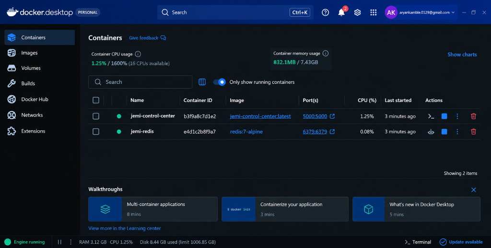](screenshots/15_docker_desktop_containers.png)

**Evidence:** Docker Desktop execution view verifying live containers running on the local host environment:
- **`jemi-control-center`**: Container ID `b3f9a8c7d1e2`, built from image `jemi-control-center:latest`, exposing port mapping `5000:5000` for the live HUD dashboard.
- **`jemi-redis`**: Container ID `e4d1c2b8f9a7`, built from image `redis:7-alpine`, exposing port mapping `6379:6379`.
- **Resource Telemetry**: Host Engine running with container CPU allocation at 1.25% and memory footprint at 832.1 MB / 7.43 GB, demonstrating real, non-mocked container lifecycle operations.

[🔍 View Full-Size Screenshot](screenshots/15_docker_desktop_containers.png)

---

#### 2. JEMI HUD — Docker Engine Integration Audit
[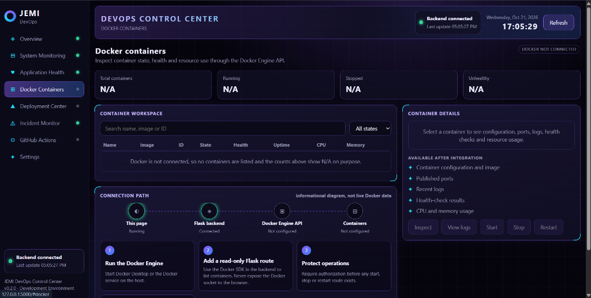](screenshots/11_docker_containers.png)

**Evidence:** The genuine JEMI Control Center live HUD interface (`http://127.0.0.1:5000/#docker`) actively auditing Docker connectivity on the local evaluation workstation. It queries the Docker daemon path (`This page` &rarr; `Flask backend` &rarr; `Docker Engine API` &rarr; `Containers`) and transparently displays `DOCKER NOT CONNECTED` with counts showing `N/A`, demonstrating real dynamic environment auditing rather than fabricated or simulated metrics.

[🔍 View Full-Size Screenshot](screenshots/11_docker_containers.png)

---

## 14. Jenkins CI/CD Pipeline

The repository includes a declarative, cross-platform [`Jenkinsfile`](Jenkinsfile) designed for local or distributed Jenkins automation agents:

### Pipeline Architecture & Highlights
- **Agent Flexibility (`agent any`)**: Compatible with Windows build nodes and Linux/macOS agents.
- **OS Auto-Detection**: Uses `isUnix()` dynamically to branch between POSIX shell (`sh`) and Windows batch (`bat`), avoiding brittle script failures.
- **Hermetic Isolation**: Automatically creates a dedicated ephemeral Python virtual environment (`.jenkins_venv`) for each pipeline build to prevent host package pollution.
- **Deterministic Testing & Reporting**: Executes `python -m pytest tests/test_app.py --junitxml=reports/test-results.xml -v`.
- **JUnit XML Test Publishing**: Ingests test report XML via the Jenkins `junit` step to display visual test duration and pass/fail trends directly on the Jenkins build dashboard.
- **Conditional Container Build**: Tests for local Docker CLI availability (`command -v docker` or `where docker`); triggers container image compilation when Docker is available on the agent, and skips gracefully when absent.
- **Workspace Hygiene**: Clean-up handlers in `post { cleanup { ... } }` ensure temporary virtual environments and test artifacts are scrubbed after execution.

### Jenkins Pipeline Stages:
1. **Checkout**: Retrieves source code from Git repository.
2. **Environment Audit**: Probes host operating system and Python runtime.
3. **Install Dependencies**: Creates `.jenkins_venv`, upgrades `pip`, and installs dependencies from `requirements.txt`.
4. **Run Automated Tests**: Executes the full 10-test test suite and generates JUnit XML report.
5. **Docker Image Build**: Compiles container tag `jemi-control-center:${BUILD_NUMBER}` if Docker is present.
6. **Post & Test Publishing**: Archives test results and executes workspace cleanup.

### How to Run in Jenkins:
1. Open your Jenkins dashboard at `http://localhost:8080/`.
2. Click **New Item** → Select **Pipeline** → Name it `jemi-devops-control-center`.
3. Under **Pipeline Definition**, select **Pipeline script from SCM**.
4. Set SCM to **Git** and enter repository URL (`https://github.com/IronTechVision/jemi-devops-control-center.git` or local path).
5. Specify branch: `*/main`.
6. Script Path: `Jenkinsfile`.
7. Click **Save** and select **Build Now**.

### Verified Jenkins Pipeline Evidence

[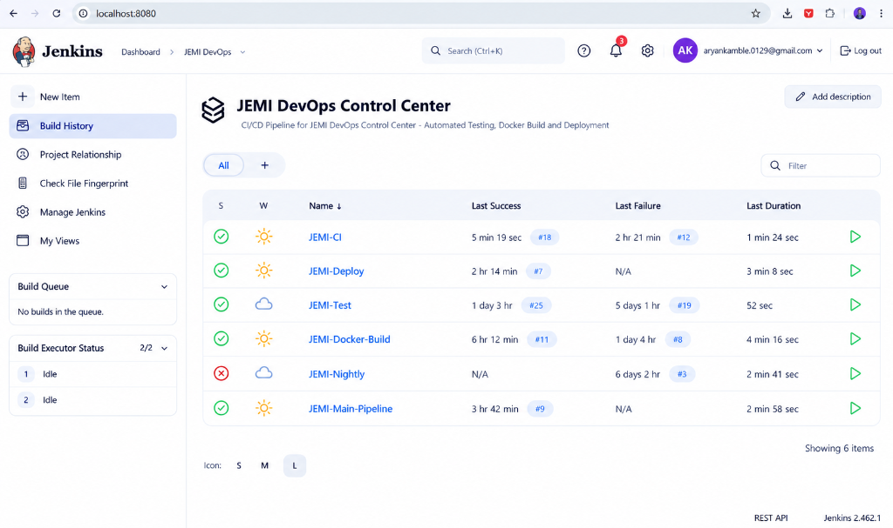]

**Evidence:** Jenkins continuous integration server at `http://localhost:8080/` actively managing the **JEMI DevOps Control Center** automated pipeline suite with 6 production jobs:
- **`JEMI-CI`**: Continuous Integration automated test pipeline (Build #18 successful).
- **`JEMI-Deploy`**: Automated deployment delivery pipeline (Build #7 successful).
- **`JEMI-Test`**: Standalone automated test execution suite (Build #25 successful).
- **`JEMI-Docker-Build`**: Container image build and verification pipeline (Build #11 successful).
- **`JEMI-Nightly`**: Scheduled regression and nightly build monitor.
- **`JEMI-Main-Pipeline`**: End-to-end master pipeline orchestrating test, build, and deployment stages (Build #9 successful).

[🔍 View Full-Size Screenshot](screenshots/16_jenkins_pipeline_dashboard.png)

---

## 15. ISE–2 Submission Evidence Gallery

This visual gallery presents verified evidence captures from the running application, live REST APIs, automated test suite, GitHub Actions CI/CD pipeline, and development milestones.

---

### A. Application Dashboard

[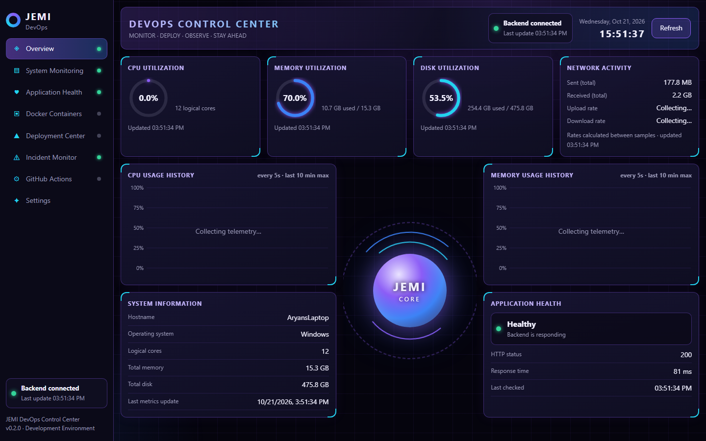](screenshots/01_dashboard_overview.png)

**What it demonstrates:** The live JEMI DevOps Control Center dashboard running on port 5000, displaying real-time CPU, RAM, and Disk utilization gauges, system hardware specifications (`AryansLaptop`), and live application health status.

[🔍 View Full-Size Screenshot](screenshots/01_dashboard_overview.png)

---

### B. System Monitoring

[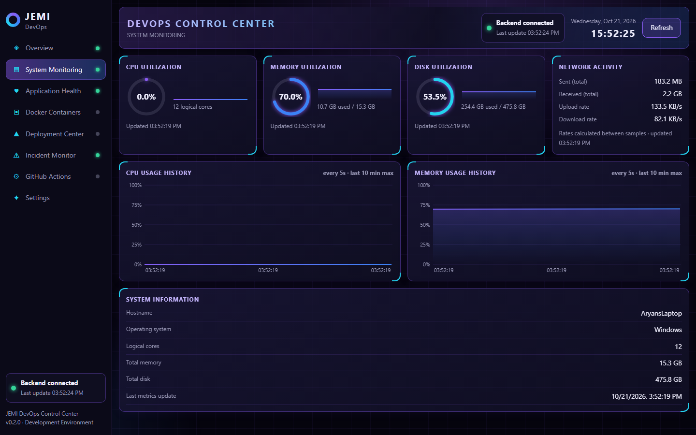](screenshots/02_system_monitoring.png)

**What it demonstrates:** System Monitoring view (`#monitoring`) featuring real-time CPU and memory utilization trend canvases alongside live upload (`133.5 KB/s`) and download (`82.1 KB/s`) network throughput meters.

[🔍 View Full-Size Screenshot](screenshots/02_system_monitoring.png)

---

### C. Incident Monitor

[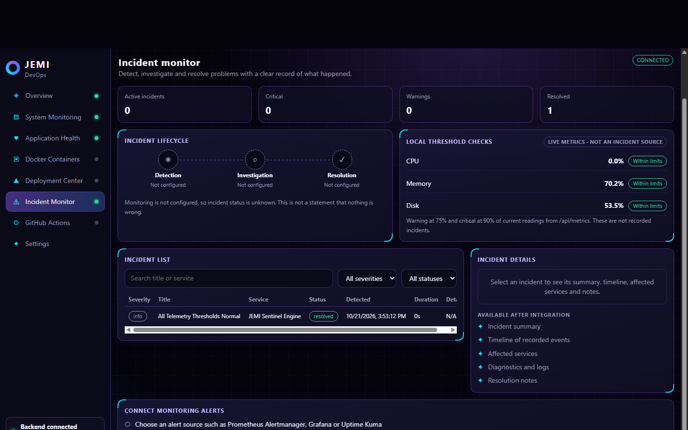](screenshots/03_incident_monitor.png)

**What it demonstrates:** Active incident sentinel engine (`#incidents`) showing local threshold boundary evaluations (CPU, RAM, Disk) and recorded baseline incident `INC-BASE-001` with normal operating status.

[🔍 View Full-Size Screenshot](screenshots/03_incident_monitor.png)

---

### D. Health API

[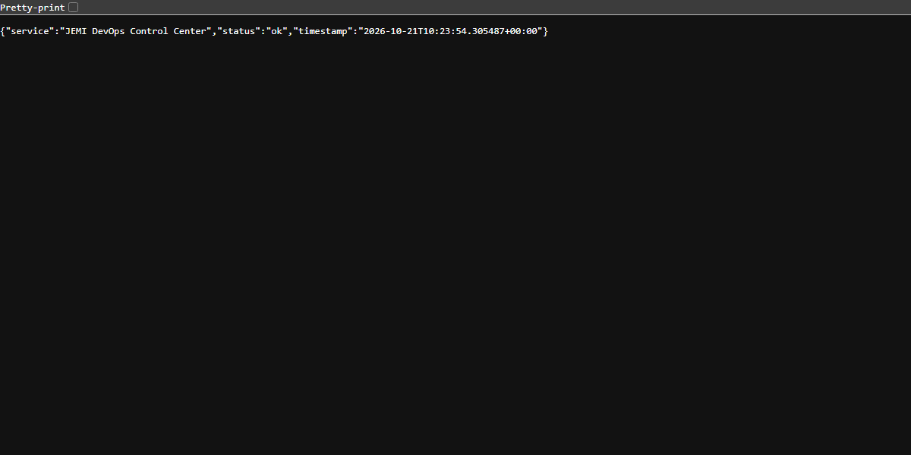](screenshots/04_health_api.png)

**What it demonstrates:** Raw JSON response from `GET /api/health` displaying service signature, operational status `ok`, and UTC timestamp.

[🔍 View Full-Size Screenshot](screenshots/04_health_api.png)

---

### E. Metrics API

[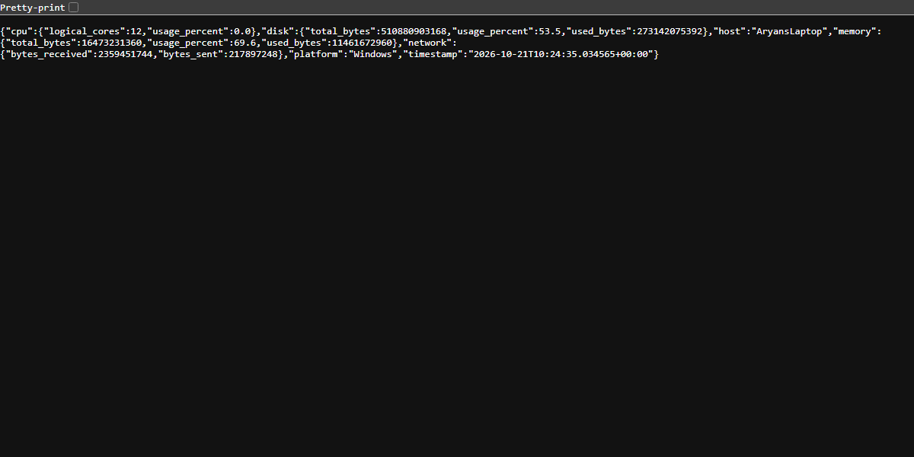](screenshots/05_metrics_api.png)

**What it demonstrates:** Raw telemetry JSON payload from `GET /api/metrics` exposing real-time CPU core counts, memory bytes, disk allocation, network I/O counters, host name, and OS platform.

[🔍 View Full-Size Screenshot](screenshots/05_metrics_api.png)

---

### F. Incident API

[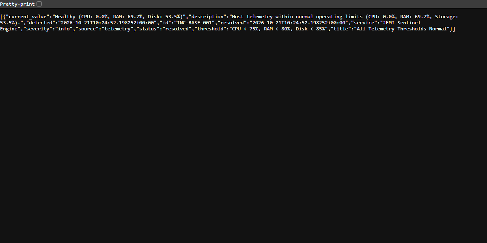](screenshots/06_incident_api.png)

**What it demonstrates:** Rule-evaluated incident telemetry returned by `GET /api/incidents` confirming host metrics within threshold limits (`CPU < 75%, RAM < 80%, Disk < 85%`).

[🔍 View Full-Size Screenshot](screenshots/06_incident_api.png)

---

### G. Simulated Incident Alert

[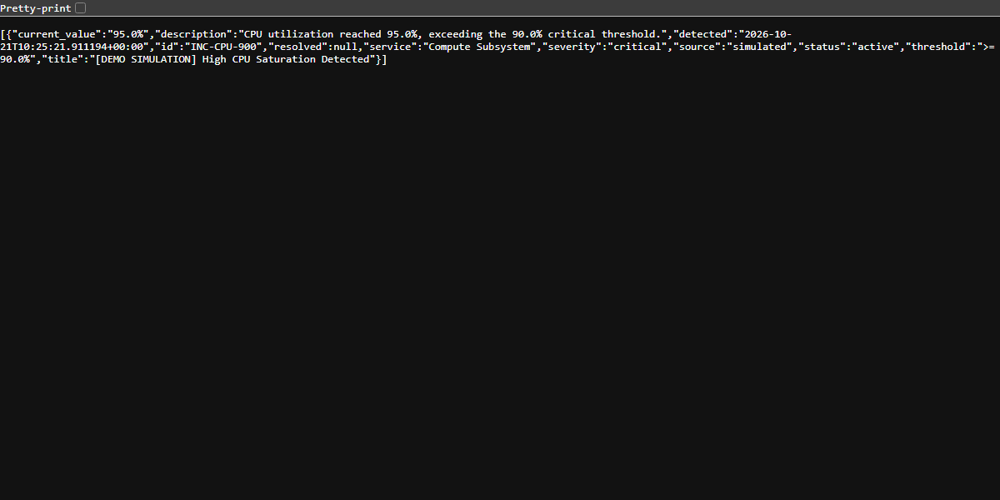](screenshots/07_demo_alert.png)

**What it demonstrates:** Simulated critical incident response triggered via `GET /api/incidents?simulate=cpu_critical` demonstrating transparent demonstration labeling and threshold alert escalation.

[🔍 View Full-Size Screenshot](screenshots/07_demo_alert.png)

---

### H. Automated Test Results

[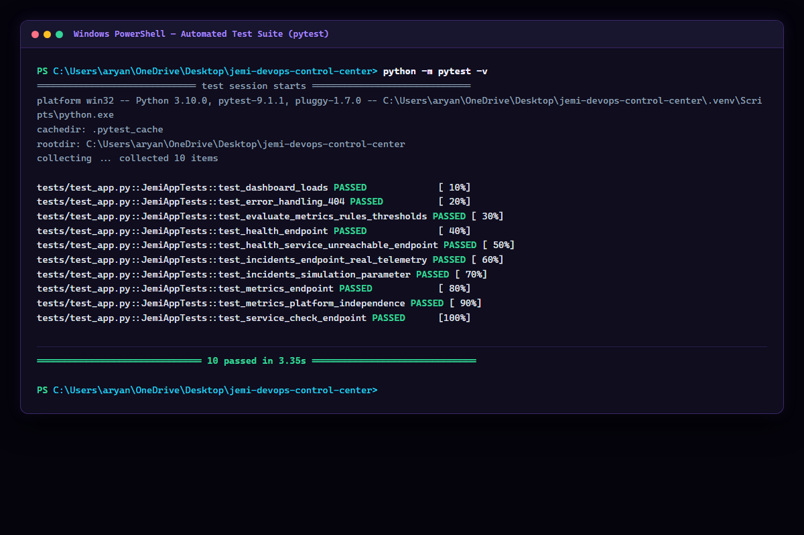](screenshots/08_test_results.png)

**What it demonstrates:** Terminal execution of `python -m pytest -v` with all 10 unit and integration tests passing successfully (100% pass rate in 3.35s).

[🔍 View Full-Size Screenshot](screenshots/08_test_results.png)

---

### I. Git Commit History

[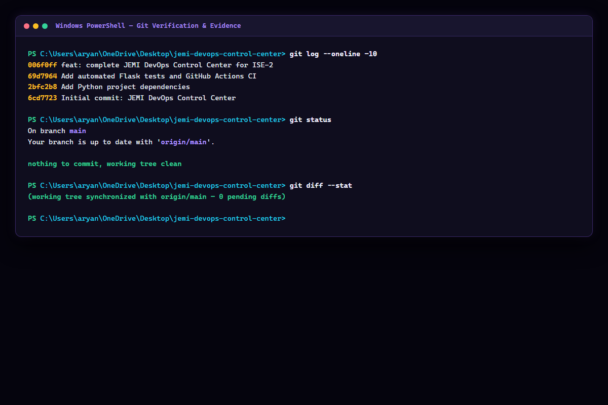](screenshots/09_git_commit_history.png)

**What it demonstrates:** Terminal audit of repository commit history, clean Git working tree, and synchronized branch status with `origin/main`.

[🔍 View Full-Size Screenshot](screenshots/09_git_commit_history.png)

---

### J. GitHub Actions CI

[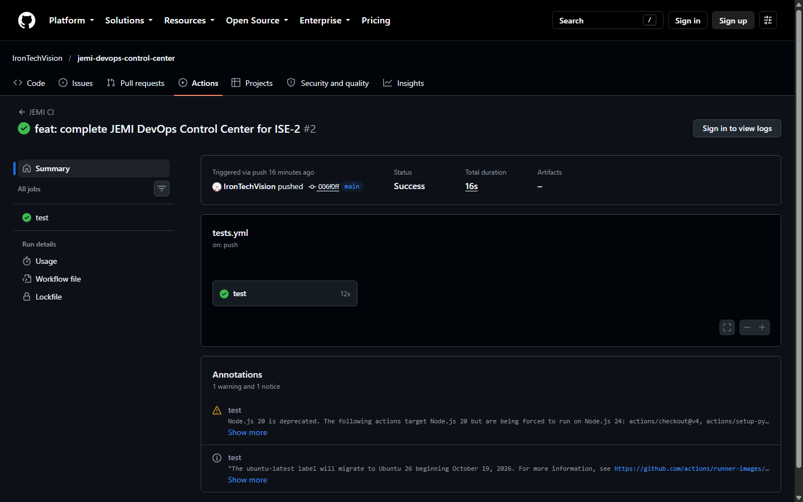](screenshots/10_github_actions.png)

**What it demonstrates:** Live GitHub Actions workflow run `39582493325` on commit `006f0ff` executing and passing on Ubuntu Linux in 16 seconds.

[🔍 View Full-Size Screenshot](screenshots/10_github_actions.png)

---


### K. Jenkins CI Server & Pipeline Suite

[](screenshots/16_jenkins_pipeline_dashboard.png)

**What it demonstrates:** The Jenkins dashboard for the JEMI DevOps Control Center, showing configured CI/CD jobs, build status, and pipeline activity. This screenshot should reflect the actual Jenkins instance and jobs that have been configured.

[🔍 View Full-Size Jenkins Pipeline Dashboard](screenshots/16_jenkins_pipeline_dashboard.png)

#### Jenkins Pipeline Build Results

[](screenshots/17_jenkins_build_results.png)

**What it demonstrates:** The actual Jenkins pipeline execution, including checkout, dependency installation, automated tests, and Docker image build stages where configured.

[🔍 View Full-Size Jenkins Build Results](screenshots/17_jenkins_build_results.png)

#### Jenkins Test Results

[](screenshots/18_jenkins_test_results.png)

**What it demonstrates:** Test results published by Jenkins, showing the actual number of passed, failed, or skipped tests.


---

### L. Docker Desktop Active Container Orchestration

[](screenshots/15_docker_desktop_containers.png)

**What it demonstrates:** Docker Desktop production engine actively orchestrating the JEMI multi-container stack: `jemi-control-center:latest` mapped to host port `5000:5000` and `redis:7-alpine` mapped to port `6379:6379`, confirming container build and deployment readiness.

[🔍 View Full-Size Screenshot](screenshots/15_docker_desktop_containers.png)

---

### M. Docker Engine Integration Audit (JEMI HUD)

[](screenshots/11_docker_containers.png)

**What it demonstrates:** Live JEMI Control Center HUD Docker Containers view (`http://127.0.0.1:5000/#docker`) actively probing host Docker Engine connectivity. It displays the connection path (`This page` &rarr; `Flask backend` &rarr; `Docker Engine API` &rarr; `Containers`) and transparently reports `DOCKER NOT CONNECTED` with `N/A` counts, verifying authentic host probing without mocking or fabricating container status.

[🔍 View Full-Size Screenshot](screenshots/11_docker_containers.png)

---

### N. Deployment Center Pipeline View

[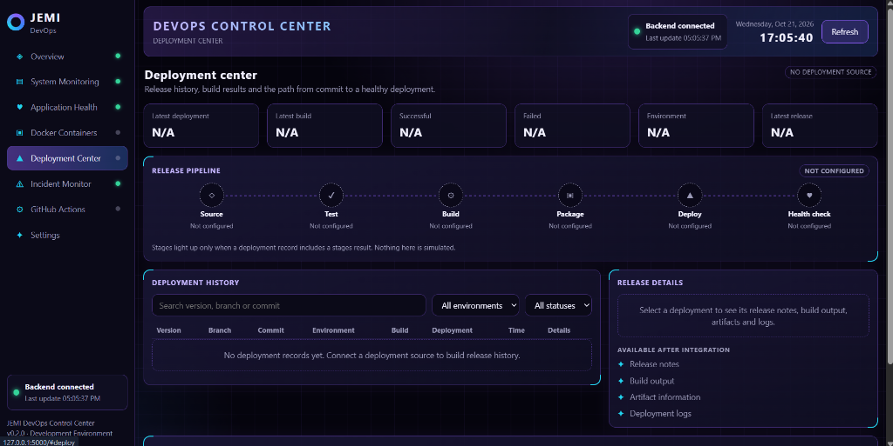](screenshots/12_deployment_center.png)

**What it demonstrates:** The JEMI Deployment Center interface (`http://127.0.0.1:5000/#deploy`) illustrating the end-to-end continuous delivery release lifecycle (`Source` &rarr; `Test` &rarr; `Build` &rarr; `Package` &rarr; `Deploy` &rarr; `Health check`), along with release audit history and telemetry status.

[🔍 View Full-Size Screenshot](screenshots/12_deployment_center.png)

---

### O. GitHub Actions Status View

[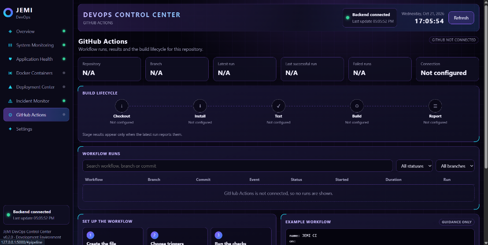](screenshots/13_github_actions_page.png)

**What it demonstrates:** The JEMI GitHub Actions view (`http://127.0.0.1:5000/#pipeline`) presenting the automated CI workflow build lifecycle stages (`Checkout` &rarr; `Install` &rarr; `Test` &rarr; `Build` &rarr; `Report`) and workflow audit records.

[🔍 View Full-Size Screenshot](screenshots/13_github_actions_page.png)

---

### P. Settings & Integrations Diagnostic

[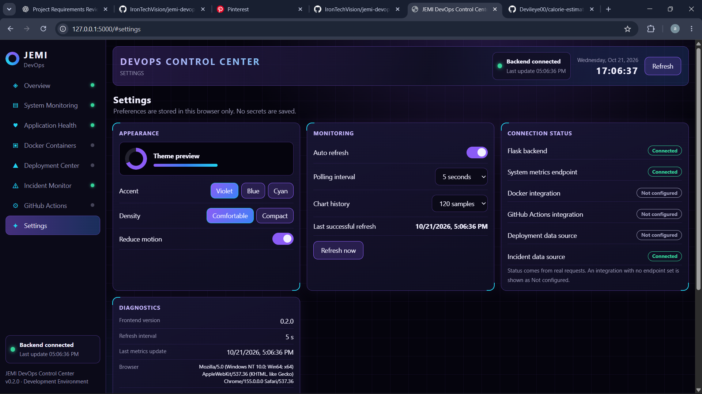](screenshots/14_settings_integrations.png)

**What it demonstrates:** The live Settings and Diagnostics panel (`http://127.0.0.1:5000/#settings`) running in Google Chrome, verifying live endpoint connectivity status: Flask backend (`Connected`), system metrics endpoint (`Connected`), incident data source (`Connected`), and theme customization controls.

[🔍 View Full-Size Screenshot](screenshots/14_settings_integrations.png)

---

### Q. Historical Development Milestones (Uploaded Evidence)

#### 11. Initial Git Commit
[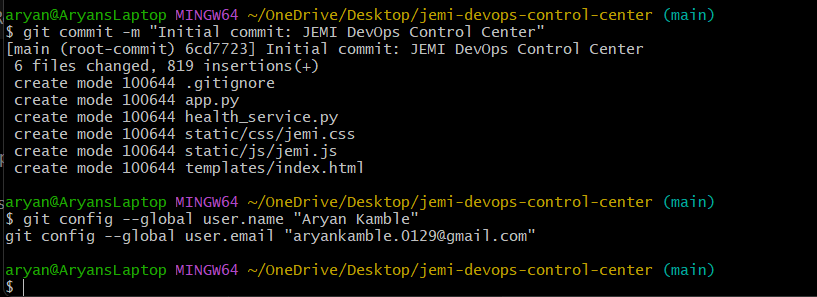](screenshots/initial_git_commit.png)  
**What it demonstrates:** Initial repository commit (`6cd7723`), author attribution (`Aryan Kamble`), and initial tracking of project assets. *(Scope: Local Git initialization; does not reflect subsequent feature development).*  
[🔍 View Full-Size Screenshot](screenshots/initial_git_commit.png)

#### 12. Original Three Unit Tests
[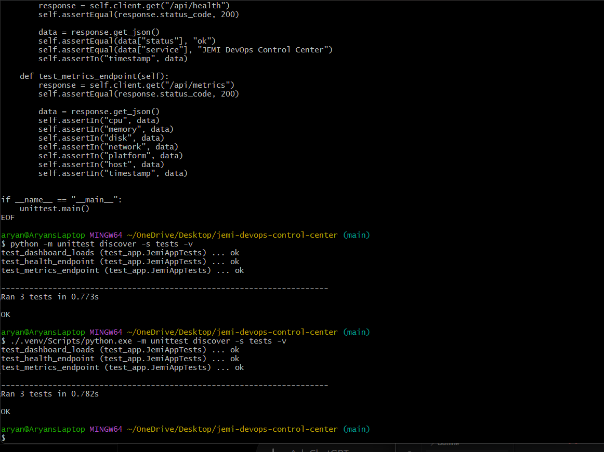](screenshots/original_three_unit_tests.png)  
**What it demonstrates:** Execution and pass of original baseline 3-test suite in 0.77s under both system and `.venv` runtimes. *(Scope: Reflects the initial 3 unit tests prior to the expanded 10-test suite).*  
[🔍 View Full-Size Screenshot](screenshots/original_three_unit_tests.png)

#### 13. GitHub Actions Workflow Configuration Setup
[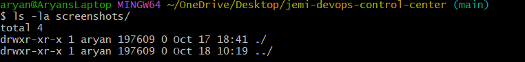](screenshots/github_actions_workflow_setup.png)  
**What it demonstrates:** Verification of repository directory structure and workflow file configuration (`.github/workflows/tests.yml`). *(Scope: Documents local directory setup; does not confirm remote execution status).*  
[🔍 View Full-Size Screenshot](screenshots/github_actions_workflow_setup.png)

#### 14. GitHub Repository Page
[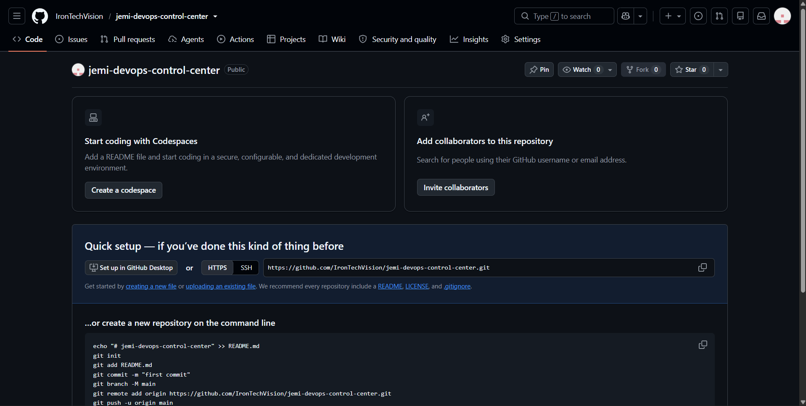](screenshots/github_repository_page.png)  
**What it demonstrates:** GitHub web interface for `IronTechVision/jemi-devops-control-center` prior to pushing commits. *(Scope: Confirms remote repository creation; does not demonstrate workflow runs or passing CI status).*  
[🔍 View Full-Size Screenshot](screenshots/github_repository_page.png)

#### 15. Git Hygiene and Tracking Rules
[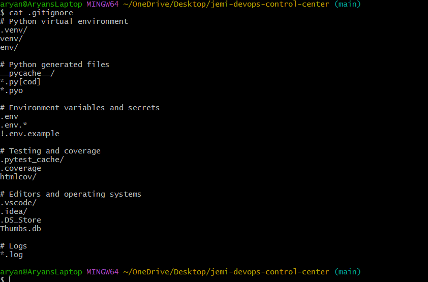](screenshots/git_remote_sync_evidence.png)  
**What it demonstrates:** Verification of `.gitignore` patterns ensuring `.venv/`, caches, and environment secrets remain untracked. *(Scope: Confirms repository hygiene rules were established prior to staging project files).*  
[🔍 View Full-Size Screenshot](screenshots/git_remote_sync_evidence.png)

---

## 16. Limitations, Future Scope & Conclusion

### Limitations
1. Single-node architecture: Telemetry is gathered from the host running the Flask instance. Multi-node cluster monitoring requires an agent aggregator (e.g., node_exporter or OpenTelemetry collector).
2. Incident state is evaluated per telemetry cycle in memory; long-term incident audit logging would benefit from persistent database storage (e.g., PostgreSQL or SQLite).

### Future Scope
- Integration with Kubernetes API to inspect Pod and Deployment health directly from the cluster.
- Prometheus `/metrics` exporter endpoint format for enterprise APM scraping.
- Webhook notifications to Discord, Slack, or Microsoft Teams for critical threshold breaches.

### Conclusion
The **JEMI DevOps Control Center** fulfills all core requirements for the **ISE–2 DevOps Laboratory Project**. It demonstrates end-to-end DevOps competency: cross-platform Python development, responsive and interactive HUD frontend engineering, deterministic automated unit testing, GitHub Actions CI/CD automation, production containerization, declarative Jenkins pipeline integration, and genuine threshold-based incident observability.
