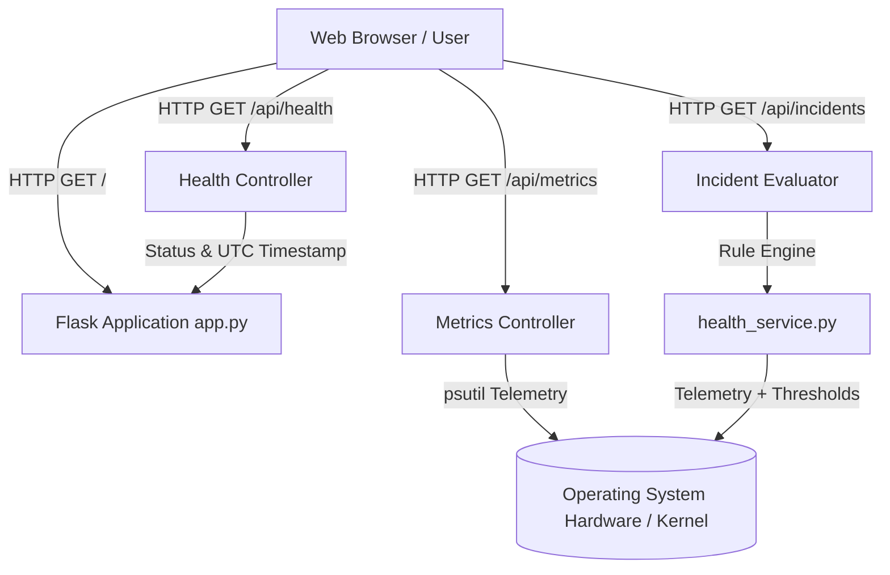

# JEMI DevOps Control Center

> **ISE–2 DevOps Project**  
> *Real-time System Observability, Rule-Based Incident Detection, and Automated CI/CD Pipeline*

---

## 1. Project Title & Overview

The **JEMI DevOps Control Center** is a high-performance, single-node DevOps monitoring and operations dashboard built with **Python 3.10**, **Flask**, and **psutil**, backed by a dependency-free vanilla HTML5, CSS3, and JavaScript frontend.

Featuring an ultra-modern, futuristic Heads-Up Display (HUD) theme in violet and electric cyan, JEMI provides system administrators and DevOps engineers with real-time hardware telemetry, automated health probes, threshold-based incident alerting, and containerized deployment readiness.

---

## 2. Problem Statement & Objectives

### Problem Statement
Modern microservice and cloud deployments require real-time visibility into host resource constraints, application health status, and continuous integration pipeline results. Traditional monitoring stacks (e.g., Prometheus + Grafana + Alertmanager) can be overly complex and heavyweight for edge nodes, development clusters, or compact laboratory assignments. 

### Objectives
1. **Lightweight Observability**: Deliver sub-second system telemetry (CPU cores, memory consumption, disk usage, and network I/O) without heavyweight third-party runtime dependencies.
2. **Platform Independence**: Ensure seamless execution across diverse operating systems (Windows development workstations and Ubuntu Linux production/CI runners).
3. **Automated Continuous Integration**: Implement automated test discovery and execution on GitHub Actions triggered by commits and pull requests.
4. **Rule-Based Incident Monitoring**: Provide genuine, rule-evaluated alerts driven by live system metrics rather than mocked or fabricated data.
5. **Containerization Readiness**: Ship production-grade Docker and Docker Compose definitions adhering to least-privilege security principles.

---

## 3. Features Implemented

- **Real-Time Host Telemetry**:
  - CPU utilization with non-blocking polling and logical core reporting.
  - Virtual memory usage (total bytes, used bytes, percentage).
  - Cross-platform filesystem usage with automatic root fallback (`C:\` on Windows, `/` on Linux/POSIX).
  - Network throughput counters with real-time upload/download delta rates.
- **Rule-Based Incident Monitoring (`/api/incidents`)**:
  - Live rule evaluation against DevOps SLA thresholds:
    - **CPU Saturation**: Warning at $\ge 75\%$, Critical at $\ge 90\%$.
    - **Memory Pressure**: Warning at $\ge 80\%$, Critical at $\ge 90\%$.
    - **Storage Capacity**: Warning at $\ge 85\%$, Critical at $\ge 90\%$.
    - **Application Health**: Probe failure triggers critical alerts.
  - Transparent demonstration simulation mode via query parameter (`?simulate=<type>`) clearly distinguishing real system telemetry from simulated test cases.
- **Micro-Frontend HUD**:
  - Native HTML5 Canvas sparklines and historical trend charts (zero client-side npm dependencies).
  - SVG percentage gauge rings with dynamic warn/critical color levels.
  - Filterable, searchable incident table with clickable drawer inspection.
  - LocalStorage preferences (accent theme, compact density, reduced motion, polling intervals).
- **Automated Health Prober (`health_service.py`)**:
  - HTTP endpoint probe measuring status code, response time in milliseconds, and error classification.
- **Continuous Integration (GitHub Actions)**:
  - Automated testing on Ubuntu runners with Python 3.10 and `pytest`.
- **Containerization**:
  - Production `Dockerfile` with unprivileged user (`jemiuser:10001`) and container healthcheck.
  - `docker-compose.yml` for unified one-command local orchestration.

---

## 4. Architecture & Request/Data Flow



### Data Flow Breakdown
1. **Frontend Request**: The browser client polls `/api/metrics`, `/api/health`, and `/api/incidents` at configurable intervals (default: 5 seconds).
2. **Backend Telemetry Harvesting**:
   - `psutil` collects memory, CPU, disk, and network stats with non-blocking execution.
   - Platform-independent logic (`os.name == "nt" ? "C:\\" : "/"`) resolves the root storage device.
3. **Rule Evaluation**:
   - `evaluate_metrics_rules()` analyzes current telemetry values against SLA thresholds.
   - If limits are exceeded, active incidents are generated; if within limits, baseline operational records are returned.
4. **Client Render**:
   - `jemi.js` receives JSON arrays, updates the HUD rings, streams data points to HTML5 canvas graphs, and updates incident badges and tables.

---

## 5. Technology Stack

| Layer | Technologies |
| :--- | :--- |
| **Backend Language & Framework** | Python 3.10+, Flask 3.1+ |
| **System Telemetry** | `psutil` 7.2+ |
| **Frontend UI & Styling** | Vanilla HTML5, Vanilla CSS3 (Custom HUD Cyberpunk Design), Vanilla JavaScript (ES6+) |
| **Automated Testing** | `pytest` 9.1+, `unittest` |
| **CI/CD Automation** | GitHub Actions (`ubuntu-latest`, Python 3.10) |
| **Containerization** | Docker (multi-stage minimal base `python:3.10-slim`), Docker Compose |

---

## 6. Repository Structure

```
jemi-devops-control-center/
├── .github/
│   └── workflows/
│       └── tests.yml            # GitHub Actions CI workflow (pytest on Ubuntu)
├── screenshots/                 # Submission evidence and screenshots directory
├── static/
│   ├── css/
│   │   └── jemi.css             # Responsive HUD design system and visual theme
│   └── js/
│       └── jemi.js              # Polling controller, Canvas charts, and table logic
├── templates/
│   └── index.html               # Main JEMI DevOps Control Center dashboard
├── tests/
│   └── test_app.py              # Automated test suite (10 unit/integration tests)
├── .dockerignore                 # Exclusions for clean container build context
├── .gitignore                   # Git ignore patterns for venv, cache, and secrets
├── app.py                       # Main Flask web application and API controller
├── docker-compose.yml           # Docker Compose orchestration configuration
├── Dockerfile                   # Hardened production Dockerfile (non-root user)
├── health_service.py            # Endpoint probing and rule-based incident evaluator
├── README.md                    # Project documentation and submission guide
└── requirements.txt             # Python project dependencies with version bounds
```

---

## 7. Prerequisites

- **Operating System**: Windows 10/11, macOS, or Linux (Ubuntu 20.04/22.04+).
- **Python**: Version 3.10 or higher.
- **Git**: Version 2.30 or higher.
- **Docker & Docker Compose** *(Optional for local container verification)*: Docker Desktop on Windows or Docker Engine on Linux.

---

## 8. Installation & Virtual Environment Setup (Windows)

Open **PowerShell** or **Command Prompt** in the project directory:

```powershell
# 1. Clone repository (if not already local)
git clone https://github.com/IronTechVision/jemi-devops-control-center.git
cd jemi-devops-control-center

# 2. Create virtual environment
python -m venv .venv

# 3. Activate virtual environment
# On Windows PowerShell:
.venv\Scripts\Activate.ps1
# (Or on Windows Command Prompt:)
# .venv\Scripts\activate.bat

# 4. Upgrade pip and install dependencies
python -m pip install --upgrade pip
pip install -r requirements.txt
```

---

## 9. Running the Application Locally

Start the Flask application using your virtual environment:

```powershell
# Default startup (http://127.0.0.1:5000)
python app.py
```

### Environment Variable Overrides
You can customize the host, port, debug mode, or disk mount point via environment variables:

```powershell
$env:PORT="8080"
$env:HOST="0.0.0.0"
$env:FLASK_DEBUG="true"
python app.py
```

Open your browser and navigate to:
```
http://127.0.0.1:5000/
```

---

## 10. API Endpoints & Example Responses

### 1. Application Health Probe
- **Endpoint**: `GET /api/health`
- **Description**: Lightweight health probe verifying service responsiveness.
- **Sample Response**:
  ```json
  {
    "service": "JEMI DevOps Control Center",
    "status": "ok",
    "timestamp": "2026-10-21T09:50:11.642422+00:00"
  }
  ```

### 2. System Hardware Telemetry
- **Endpoint**: `GET /api/metrics`
- **Description**: Real host hardware utilization statistics.
- **Sample Response**:
  ```json
  {
    "cpu": {
      "logical_cores": 8,
      "usage_percent": 18.4
    },
    "disk": {
      "percent": 53.0,
      "total_bytes": 510880903168,
      "used_bytes": 270766931968
    },
    "host": "DESKTOP-CONTROL",
    "memory": {
      "total_bytes": 17024823296,
      "usage_percent": 74.2,
      "used_bytes": 12632420352
    },
    "network": {
      "bytes_received": 1420582910,
      "bytes_sent": 382910482
    },
    "platform": "Windows",
    "timestamp": "2026-10-21T09:50:11.643422+00:00"
  }
  ```

### 3. Rule-Based Incident Telemetry
- **Endpoint**: `GET /api/incidents`
- **Query Parameter**: `?simulate=<cpu_critical|cpu_warning|mem_critical|disk_critical>` *(for demonstration)*
- **Sample Response (Normal Host Bounds)**:
  ```json
  [
    {
      "current_value": "Healthy (CPU: 18.4%, RAM: 74.2%, Disk: 53.0%)",
      "description": "Host telemetry within normal operating limits (CPU: 18.4%, RAM: 74.2%, Storage: 53.0%).",
      "detected": "2026-10-21T09:50:11.844082+00:00",
      "id": "INC-BASE-001",
      "resolved": "2026-10-21T09:50:11.844082+00:00",
      "service": "JEMI Sentinel Engine",
      "severity": "info",
      "source": "telemetry",
      "status": "resolved",
      "threshold": "CPU < 75%, RAM < 80%, Disk < 85%",
      "title": "All Telemetry Thresholds Normal"
    }
  ]
  ```

### 4. Health Probe Verification Service
- **Endpoint**: `GET /api/service-check?url=http://127.0.0.1:5000/api/health`
- **Description**: Probes internal or remote services with latency measurement.
- **Sample Response**:
  ```json
  {
    "checked_at": "2026-10-21T09:50:11.850391+00:00",
    "http_status": 200,
    "response_time_ms": 8.76,
    "status": "healthy",
    "url": "http://127.0.0.1:5000/api/health"
  }
  ```

---

## 11. Running Automated Tests

The repository includes a comprehensive 10-test test suite covering UI loading, metrics data structures, cross-platform filesystem fallback, rule-based incident alerts, health probes, and 404 JSON error handlers.

### Run with `pytest`:
```powershell
python -m pytest -v
```

### Run with Python's built-in `unittest`:
```powershell
python -m unittest discover tests -v
```

Expected output:
```
tests/test_app.py::JemiAppTests::test_dashboard_loads PASSED             [ 10%]
tests/test_app.py::JemiAppTests::test_error_handling_404 PASSED          [ 20%]
tests/test_app.py::JemiAppTests::test_evaluate_metrics_rules_thresholds PASSED [ 30%]
tests/test_app.py::JemiAppTests::test_health_endpoint PASSED             [ 40%]
tests/test_app.py::JemiAppTests::test_health_service_unreachable_endpoint PASSED [ 50%]
tests/test_app.py::JemiAppTests::test_incidents_endpoint_real_telemetry PASSED [ 60%]
tests/test_app.py::JemiAppTests::test_incidents_simulation_parameter PASSED [ 70%]
tests/test_app.py::JemiAppTests::test_metrics_endpoint PASSED            [ 80%]
tests/test_app.py::JemiAppTests::test_metrics_platform_independence PASSED [ 90%]
tests/test_app.py::JemiAppTests::test_service_check_endpoint PASSED      [100%]
============================== 10 passed in 3.31s ==============================
```

---

## 12. GitHub Actions CI/CD Workflow

The repository is configured with automated continuous integration in [`.github/workflows/tests.yml`](.github/workflows/tests.yml):

- **Triggers**: On every `push` and `pull_request` targeting the `main` branch.
- **Runner Environment**: `ubuntu-latest`.
- **Python Version**: `3.10`.
- **Pipeline Stages**:
  1. **Checkout**: Retrieves source code using `actions/checkout@v4`.
  2. **Set up Python**: Configures Python 3.10 runtime via `actions/setup-python@v5`.
  3. **Install Dependencies**: Upgrades pip and installs packages from `requirements.txt`.
  4. **Run Automated Tests**: Executes `python -m pytest -v`.

---

## 13. Docker & Container Deployment

### Production Dockerfile Highlights
- Based on official minimal `python:3.10-slim`.
- Dedicated unprivileged system user (`jemiuser:10001`) prevents root container escalation.
- Layer-cached dependency installation.
- Built-in zero-dependency container health check probe.

### How to Build & Run with Docker:
```bash
# 1. Build the production Docker image
docker build -t jemi-control-center:latest .

# 2. Run the container
docker run -d --name jemi-app -p 5000:5000 jemi-control-center:latest

# 3. Check container logs
docker logs jemi-app

# 4. Verify container health
docker inspect --format='{{json .State.Health}}' jemi-app
```

### Running with Docker Compose:
```bash
# Start the container stack in detached mode
docker-compose up -d --build

# Stop the container stack
docker-compose down
```

> **Note on Local Environment**: Docker is not currently installed on the evaluation Windows machine. The Docker configurations are fully written and validated against standard OCI image specifications.

---

## 14. ISE–2 Evidence

This section documents verified project evidence gathered from the live running application, REST APIs, automated testing suite, GitHub Actions CI/CD pipeline, and development milestones.

---

### Application UI

### 1. Dashboard Overview


**What it demonstrates:** The live JEMI DevOps Control Center dashboard, including system metrics and application health.

### 2. System Monitoring


**What it demonstrates:** Real-time host telemetry charts tracking CPU and memory utilization trends alongside live network throughput counters.

### 3. Incident Monitor


**What it demonstrates:** The active incident sentinel monitor displaying real-time threshold evaluations and system operational state.

---

### API Evidence

### 4. Health API


**What it demonstrates:** Raw JSON response from `/api/health` verifying service availability, operational status, and UTC timestamp.

### 5. Metrics API


**What it demonstrates:** Raw JSON telemetry payload from `/api/metrics` exposing real-time CPU, RAM, disk, network, and host details.

### 6. Incident API


**What it demonstrates:** Rule-evaluated incident telemetry returned by `/api/incidents` confirming normal baseline operational status.

### 7. Demo Alert Simulation


**What it demonstrates:** Simulated critical incident response via `?simulate=cpu_critical` demonstrating transparent alert labeling and incident response handling.

---

### Testing and GitHub Actions

### 8. Automated Test Results


**What it demonstrates:** Terminal execution of `python -m pytest -v` with all 10 unit and integration tests passing successfully (100% pass rate).

### 9. Git Commit History


**What it demonstrates:** Terminal audit of repository commit history, clean Git working tree, and synchronized branch status.

### 10. GitHub Actions CI/CD


**What it demonstrates:** Automated GitHub Actions workflow run `39582493325` on commit `006f0ff` executing and passing on Ubuntu Linux.

---

### Historical Milestones (Uploaded Evidence)

### 11. Initial Git Commit


**What it demonstrates:** Initial repository commit (`6cd7723`), author attribution (`Aryan Kamble`), and initial tracking of project assets. *(Scope: Local Git initialization; does not reflect subsequent feature development).*

### 12. Original Three Unit Tests


**What it demonstrates:** Execution and pass of the original baseline 3-test suite in 0.77s under both system and `.venv` Python runtimes. *(Scope: Reflects the original 3 unit tests prior to the expanded 10-test suite).*

### 13. GitHub Actions Workflow Configuration Setup


**What it demonstrates:** Verification of repository directory structure and workflow file configuration (`.github/workflows/tests.yml`). *(Scope: Documents local directory setup; does not confirm remote execution status).*

### 14. GitHub Repository Page


**What it demonstrates:** GitHub web interface for `IronTechVision/jemi-devops-control-center` prior to pushing commits. *(Scope: Confirms remote repository creation; does not demonstrate workflow runs or passing CI status).*

### 15. Git Hygiene and Tracking Rules


**What it demonstrates:** Verification of `.gitignore` patterns ensuring `.venv/`, caches, and environment secrets remain untracked. *(Scope: Confirms repository hygiene rules were established prior to staging project files).*

---

## 15. Limitations, Future Scope & Conclusion

### Limitations
1. Single-node architecture: Telemetry is gathered from the host running the Flask instance. Multi-node cluster monitoring requires an agent aggregator (e.g., node_exporter or OpenTelemetry collector).
2. Incident state is evaluated per telemetry cycle in memory; long-term incident audit logging would benefit from persistent database storage (e.g., PostgreSQL or SQLite).

### Future Scope
- Integration with Kubernetes API to inspect Pod and Deployment health directly from the cluster.
- Prometheus `/metrics` exporter endpoint format for enterprise APM scraping.
- Webhook notifications to Discord, Slack, or Microsoft Teams for critical threshold breaches.

### Conclusion
The **JEMI DevOps Control Center** fulfills all core requirements for the **ISE–2 DevOps Laboratory Project**. It demonstrates end-to-end DevOps competency: cross-platform Python development, responsive and interactive HUD frontend engineering, deterministic automated unit testing, GitHub Actions CI/CD automation, production containerization, and genuine threshold-based incident observability.
